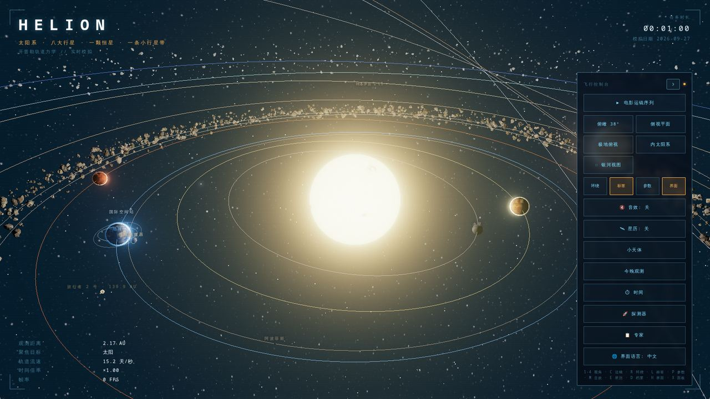
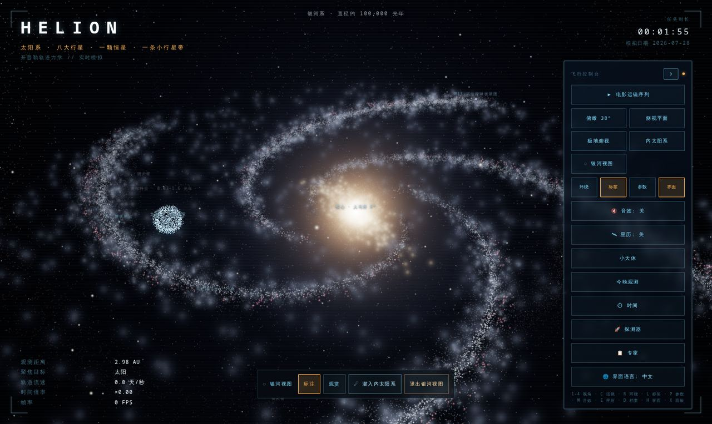
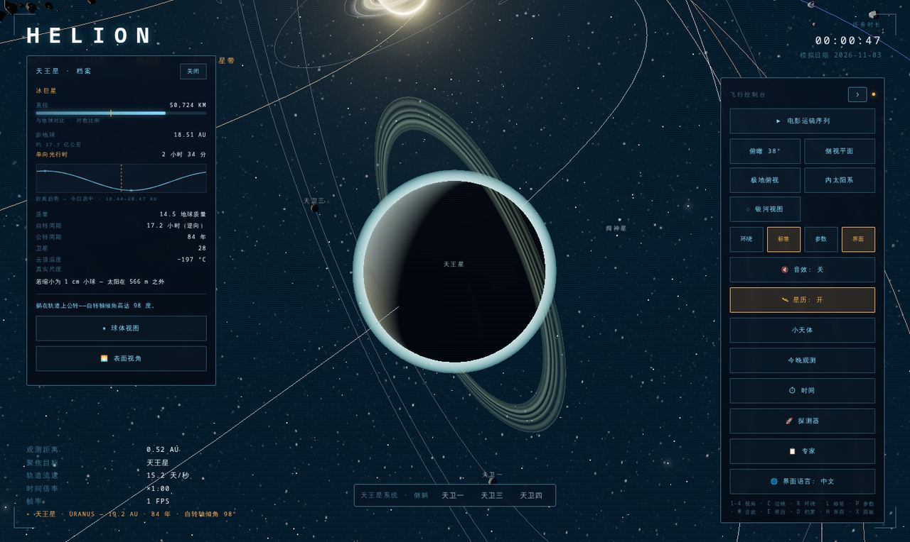
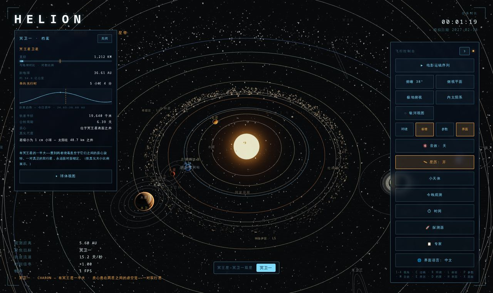
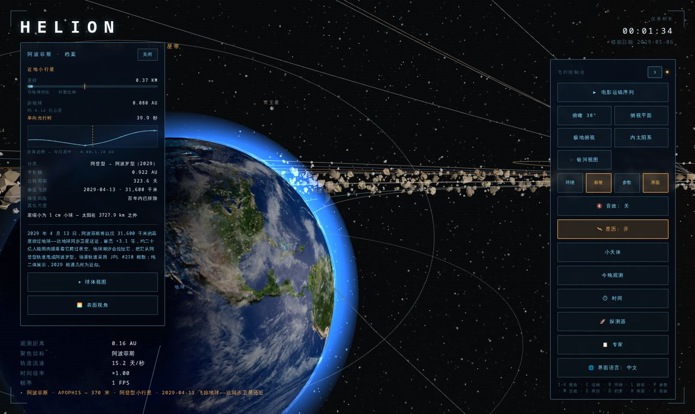
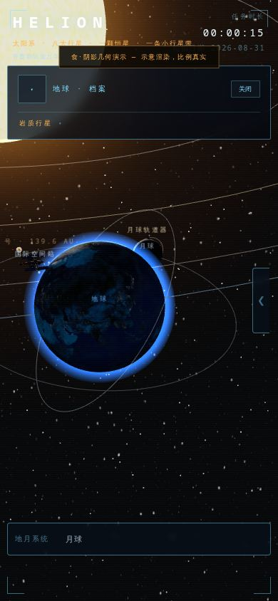

# HELION · 太阳系观测站

> 一个运行在浏览器里的实时太阳系模拟器 —— 开普勒轨道力学驱动的观测站，
> 从地表仰望到银河俯瞰，一镜到底。



[English README below](#english)

---

## ✦ 这是什么

HELION 是一个交互式 3D 太阳系观测站。八大行星、矮行星、卫星系统、
小行星带、柯伊伯带、特洛伊群、彗星与探测器——全部按照 J2000 平根数
解析星历实时推演，时间可以暂停、倒放、千倍加速，也可以一键跳转到
任何日期，或者跳进银河系的尺度回望太阳系。

**在线体验**：部署后打开网页即是观测站，无需安装任何东西。

## ✦ 核心能力

### 轨道与天体
- **解析星历**：J2000 平根数 + 长期项，八大行星到 3000 年误差 < 1°
- **卫星系统 ×6**：地月系、火星双卫（火卫一西升东落）、木星伽利略四卫、
  土星伴星、天王星系统（整体侧躺 97.8°）、海卫一（逆行轨道）、
  冥王星–冥卫一双星（质心在体外）
- **木星特洛伊群**：L4 希腊营 / L5 特洛伊营双营云，逐帧跟随木星
- **阿波菲斯 2029 飞掠**：JPL #218 根数，2029-04-13 与地球黄经差 0.18°
- 小行星带、柯伊伯带、哈雷彗星、旅行者 1/2 号、国际空间站

### 时间操控
- 暂停 / 倒放 / ×1 / ×10 / ×100 / ×1000 六档倍率
- 日期跳转（UTC）+ ±30 年时间轴拖动
- **事件引擎**：会合、冲日、日食/月食、飞掠——解析法求解，
  「跳到下一事件」自动对齐时间

### 观测模式
- **球体视图**：贴着任何一颗行星/卫星的表面环绕
- **表面视角**：站在地表看天空，太阳角径实时计算
- **今晚观测**：按城市算出今晚可见的行星与升起/落下时间
- **探测器模式**：飞掠 / 撞击 / 捕获三种任务，转移轨道实时预测

### 银河尺度
- 一键飞出太阳系：猎户臂、银心、球状星团、麦哲伦流
- **电影级过渡**：10.5 秒掠日俯冲，从内太阳系直达银河全景，再俯冲回家
- 银河中点击深空天体可聚焦查看档案

### 档案与界面
- 每个天体一份实时档案：直径对数尺、距地球（活数据）、单向光行时、
  距离趋势图、真实尺度换算（"若缩小为 1 cm 小球"）
- 中英双语一键切换
- 电影运镜序列：自动巡航八大行星
- **移动端完整适配**：底部抽屉控制台、档案摘要条、全宽卫星条、
  面板互让零重叠、刘海屏 safe-area 适配

## ✦ 截图

| 银河全景 | 天王星卫星系统 |
|:---:|:---:|
|  |  |

| 特洛伊双营 | 阿波菲斯 2029 飞掠 |
|:---:|:---:|
|  |  |

| 移动端 |
|:---:|
|  |

## ✦ 快速开始

```bash
npm install
npm run dev      # 开发服务器
npm run build    # 构建到 dist/
npm run preview  # 预览构建产物
```

纯静态站点——`dist/` 目录丢到任何静态托管（GitHub Pages / Vercel /
Netlify / Nginx）即可运行。

## ✦ 键盘快捷键

| 按键 | 功能 | 按键 | 功能 |
|---|---|---|---|
| `1-4` | 视角切换（4 = 内太阳系俯冲） | `C` | 电影运镜 |
| `R` | 环绕 | `L` | 标签 |
| `T` | 时间面板 | `D` | 档案卡 |
| `G` | 探测器模式 | `V` | 探测器跟随 |
| `B` | 表面视角 | `E` | 星历 |
| `M` | 音效 | `H` | 界面 |
| `X` | 控制台 | `Esc` | 退出当前模式 |

## ✦ 技术栈

React 19 · TypeScript · Vite · Three.js 0.185 · Tailwind CSS

- 纹理全部**程序化生成**（Canvas 手绘：陨石坑、冰峡谷、氮喷泉条纹…）
- 音效全部 **WebAudio 程序化合成**，零音频资源文件
- 无后端、无数据库，一切计算在浏览器本地完成

## ✦ 科学诚实性声明

这个项目的尺度是**压缩的**（否则行星小得看不见），部分轨道是**近似的**：

- 阿波菲斯为纯二体展示，2029 相遇几何为近似值，未模拟地球潮汐弯曲
- 卫星轨道由"表演时钟"驱动（真实周期压缩到秒级），距离按真实比例
  开方缩放；唯冥卫一使用诚实的 0.51× 半径比
- 麦哲伦流在场景中按气体流而非恒星渲染
- 所有纹理为程序化艺术再现，非真实照片

观测站追求的不是照片级还原，而是**几何上诚实、视觉上动人**。

---

## English

**HELION — a real-time Solar System observatory in your browser.**

Keplerian mechanics (J2000 mean elements) drives every planet, dwarf planet,
moon system, trojan swarm, comet and probe. Pause, reverse or thousand-fold
time; jump to any date; ride a 10.5-second cinematic dive from the galactic
panorama back into the inner solar system.

- 6 moon systems (incl. retrograde Triton, sideways Uranus, Pluto–Charon binary)
- Jupiter trojans: Greek camp L4 / Trojan camp L5, frame-locked to Jupiter
- Apophis 2029-04-13 flyby from JPL solution #218
- Event engine: conjunctions, oppositions, eclipses, flybys — solved analytically
- Globe view, surface view, tonight-sky planner, probe missions
- Full mobile adaptation: bottom-sheet deck, collapsible dossier, safe-area aware
- All textures procedurally painted; all audio procedurally synthesized

```bash
npm install && npm run dev
```

Static site — deploy `dist/` anywhere.

**Honesty note**: scales are compressed, some orbits are approximate
(marked in-app), textures are artistic recreations. Geometrically honest,
visually moving.

---

*HELION — 开普勒轨道力学 // 实时模拟*
